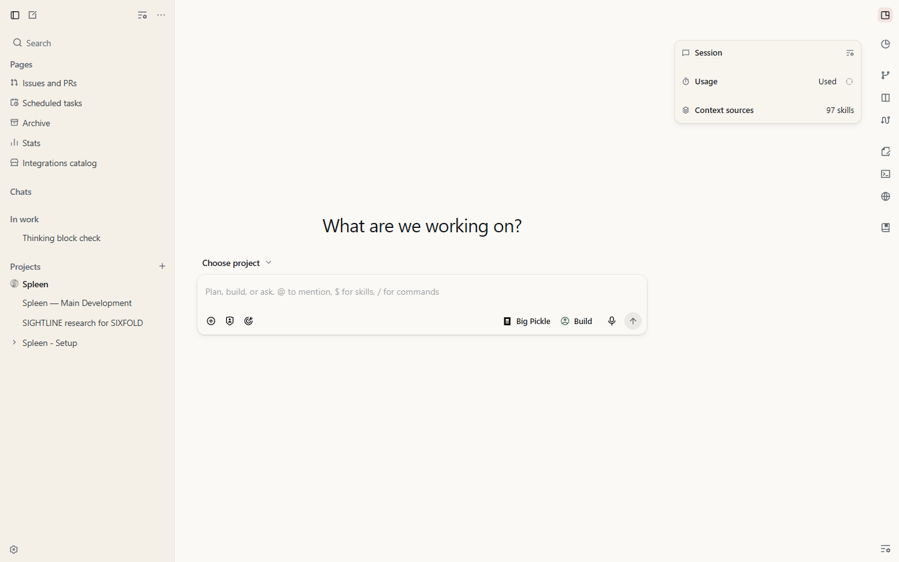

# <picture><source media="(prefers-color-scheme: dark)" srcset="docs/references/badges/spleen-logo-dark.svg"></picture> Spleen

[](https://github.com/whft/spleen/releases/latest)
[](LICENSE)

Spleen is an independent OpenCode workspace. The desktop app is a Tauri 2 host; no Electron runtime is shipped.

## Run agent work. Keep control. Ship from anywhere.

**Spleen is an open-source workspace for running and reviewing AI coding work on desktop, web, VS Code, and mobile.**

Start agent work, see what changed, and take it through review and release. Your projects and sessions remain available when you switch devices or step away.

<picture><source media="(prefers-color-scheme: dark)" srcset="docs/references/desktop_dark.png"></picture>

## What you can do with Spleen

### Goals that continue on their own

Give a session a finish line with **Session Goals**. Spleen checks the result after every turn and keeps the agent working until it completes the goal, gets blocked, or reaches the limit you set. It can continue after you close the app.

### Compare and combine runs

Use **Multi-run** to give the same task to up to five models, each in its own session and optionally its own worktree. See what each one actually built, choose the best result, or use **Fusion** to combine the strongest parts into a new session.

### Guided changes walkthroughs

**Changes Walkthrough** turns a large diff into an AI-guided tour of the change. It groups related edits into steps, puts them in the order the change makes sense, and explains how the pieces fit together.

### Inspect a running app

Open your app beside the conversation with **Preview**. Point at an element to send the agent its screenshot, styles, position, and browser errors. No more trying to explain "this thing here." The desktop app can do the same with any web page in its built-in browser.

### GitHub context from issue to pull request

Start a session from a GitHub issue or pull request with its context attached. Send failed checks or review comments back to the agent, then update or merge the pull request from Spleen.

### Continue on another device

Open the same projects and sessions from Desktop, Web/PWA, VS Code, iOS, or Android. Check progress, answer questions, review changes, and reattach to a running terminal.

### Private remote access

Pair a device with a one-time QR code and connect through **Private Relay** without opening ports or exposing a public server. The connection is end-to-end encrypted and can be revoked at any time. Direct connections, LAN/VPN access, and Cloudflare/Ngrok tunnels are also supported.

### Track work across projects

See which sessions are working, waiting, finished, or failed, along with approvals, scheduled tasks, provider limits, token use, and costs. Organize sessions into folders and keep notes, todos, and reusable project actions nearby.

### Schedule recurring work

Run a prompt once, daily, weekly, or on a cron schedule. Scheduled tasks can use Session Goals, so they continue toward an outcome instead of stopping after one response.

## Use it where you work

| Surface | Role |
| --- | --- |
| **Desktop** | The Windows workspace: run and review sessions, approve work, and get native notifications from a Tauri 2 shell |
| **Web / PWA** | Open your workspace in a browser, install it as an app, and stay up to date through background notifications |
| **VS Code** | Keep sessions beside your code, send selections to the agent, open results in the editor, and compare parallel runs |
| **iOS / Android** | Review and steer work away from your desk, receive completion alerts, and use the terminal with touch controls |
| **CLI / Server** | Run Spleen on a workstation or server, schedule work, manage remote access, and keep it available after login |

## Quick start

### Windows desktop

The desktop app targets Windows 10/11 with WebView2. Release artifacts are not published yet; build the unsigned installer from source with [Windows development](docs/operations/WINDOWS-DEV.md). The installer bundles the matching OpenCode CLI, so no separate OpenCode installation is required.

The local build writes `Spleen_<version>_x64-setup.exe` under `packages/desktop/src-tauri/target/release/bundle/nsis/`.

### VS Code

Build the extension from [`packages/vscode`](packages/vscode/README.md). A Marketplace listing is not published yet.

### iOS and Android

The shells build from [`packages/mobile`](packages/mobile/README.md); no public binary is published yet.

### CLI for Web and PWA

Requires Node.js 24.14+. CLI/Web and VS Code use your installed [OpenCode CLI](https://opencode.ai).

After installing the `spleen` CLI, common operations are:

```bash
spleen status
spleen connect-url --qr
spleen tunnel start --provider cloudflare --mode quick --qr
spleen startup enable
spleen logs
spleen stop
spleen update
```

Spleen binds to localhost by default. Use `--lan` only on a trusted network and protect browser access with `--ui-password`.

## Guides

Go deeper with the Spleen guides:

- [Quick start](packages/docs/content/docs/quickstart.mdx)
- [Installation](packages/docs/content/docs/install.mdx)
- [Connect devices](packages/docs/content/docs/connect-devices.mdx)
- [Private Relay](packages/docs/content/docs/private-relay.mdx)
- [Multi-run](packages/docs/content/docs/multi-run.mdx)
- [Session Goals](packages/docs/content/docs/session-goals.mdx)
- [Changes Walkthrough](packages/docs/content/docs/walkthrough.mdx)
- [Preview and dev servers](packages/docs/content/docs/preview.mdx)
- [GitHub workflows](packages/docs/content/docs/github.mdx)
- [Mobile](packages/docs/content/docs/mobile.mdx)
- [Security](packages/docs/content/docs/security.mdx)
- [Troubleshooting](packages/docs/content/docs/troubleshooting.mdx)

For self-hosting details, see the [reverse proxy guide](docs/REVERSE_PROXY.md). For custom theme authoring, see the [custom themes guide](docs/CUSTOM_THEMES.md).

## Why OpenCode?

Spleen uses [OpenCode](https://opencode.ai) to run coding agents. We chose it because it is open source, has a solid API, and is easy to extend.

Spleen handles the rest of the workflow. You can decide what to try, keep the agent on track, review the result, connect from another device, and ship the change.

Spleen is an independent project and is not affiliated with the OpenCode team.

## Contributing

Bug fixes are welcome as PRs that link their bug report. Features and behavior changes start as a [feature request](https://github.com/whft/spleen/issues/new?template=feature_request.yml), and building starts once it is marked `accepted`. Read [CONTRIBUTING.md](./CONTRIBUTING.md) before opening a PR; it has the setup, the review contract, and what happens to a PR without a linked issue. Documentation authoring guidance lives in [`packages/docs`](packages/docs/README.md).

Bugs go to [issues](https://github.com/whft/spleen/issues/new/choose). Questions go to [Q&A discussions](https://github.com/whft/spleen/discussions/categories/q-a).

## Acknowledgments

Special thanks to:

- [OpenCode](https://opencode.ai) for the API and open-source architecture Spleen builds on
- [OpenChamber](https://github.com/fedaykindev/openchamber), the MIT-licensed source Spleen was rebranded from
- [Pierre](https://pierrejs-docs.vercel.app/) for the diff viewer and syntax highlighting
- The [T3 Code](https://github.com/pingdotgg/t3code) team for their browser adapter for [libghostty-vt](https://github.com/ghostty-org/ghostty), which our terminal is built on
- [Yulia Ivashko](https://github.com/yulia-ivashko), who built the firework celebration that plays on every successful push
- Everyone who contributed code, reported bugs, or shared ideas

## License

MIT
