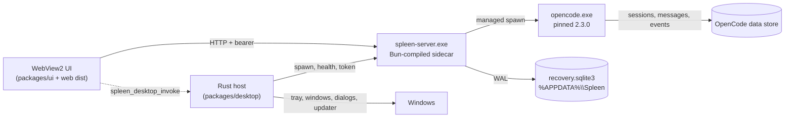

# Architecture

Spleen keeps the OpenChamber UI and web/API server. The Electron main process is
replaced by a Tauri 2 host written in Rust.

## Processes

1. **Rust host** (`packages/desktop/src-tauri`): single instance, tray, window,
   paths, sidecar supervision, job object that kills owned children on exit,
   graceful `/api/system/shutdown` then kill, updater plugin, bridge commands
   for native features.
2. **Sidecar** (`packages/web`, compiled to `spleen-server.exe`): HTTP server,
   static UI, SSE/WS event bridge, OpenCode lifecycle, Spleen feature runtimes.
   Bound to `127.0.0.1` on a free port with a per-launch UI password.
3. **OpenCode** (`resources/opencode-cli/opencode.exe`, pinned 2.3.0): managed
   `serve` on another loopback port with a rotated password. It owns sessions,
   messages, tool execution and the durable event log.

No Electron runtime, preload or Electron updater is shipped.

## Boot

1. Host resolves resources (`binaries/`, `web-dist/`, `opencode-cli/`,
   `built-in-extensions/`), creates `%APPDATA%\Spleen` once, picks a free port.
2. Host spawns the sidecar with `SPLEEN_DATA_DIR`, `SPLEEN_DIST_DIR`,
   `SPLEEN_BUILTIN_EXTENSIONS_DIR`, `SPLEEN_BUNDLED_OPENCODE_CLI_DIR`,
   `SPLEEN_RUNTIME=desktop`, `SPLEEN_RELAY_HOST=off`.
3. Host waits for `/health` (120s), exchanges the UI password for a client
   token, and injects origin, token and runtime globals into the webview.
4. Sidecar starts, serves the SPA, starts the managed OpenCode and its API gate.
5. Recovery coordinator takes its lease and reconciles pending executions
   (`docs/architecture/RECOVERY.md`).

## Paths

| Data | Location |
|---|---|
| Desktop settings | `%APPDATA%\Spleen\desktop.json`, `desktop-hosts.json` |
| Server log | `%LOCALAPPDATA%\Spleen\logs\server.log` |
| Downloads | `%LOCALAPPDATA%\Spleen\downloads` |
| Recovery ledger | `%APPDATA%\Spleen\recovery.sqlite3` |
| OpenCode data | OpenCode's own store (unchanged, shared with existing installs) |

## Security boundary

- Loopback only by default; no wildcard CORS; ephemeral password and bearer
  token; origin checks on API requests.
- The webview receives only a token and an origin, never a shell.
- Native commands are validated per command in `bridge.rs`; capabilities are
  least-privilege in `capabilities/desktop.json`.
- The sidecar cannot be reached from another machine unless the user opts into
  a tunnel or LAN mode.

## Compiled sidecar constraints

Bun `--compile` embeds only statically imported modules and assets. Runtime
reads of sibling files (`readFileSync(new URL(...))`, `createRequire` of JSON)
fail in the compiled binary. Server code that needs an asset embeds it with a
JSON or text import, or receives a directory path from the host
(`SPLEEN_DIST_DIR`, `SPLEEN_BUILTIN_EXTENSIONS_DIR`). The CLI entry check must
accept `Bun.main`, because `__filename` keeps the build-machine path.
