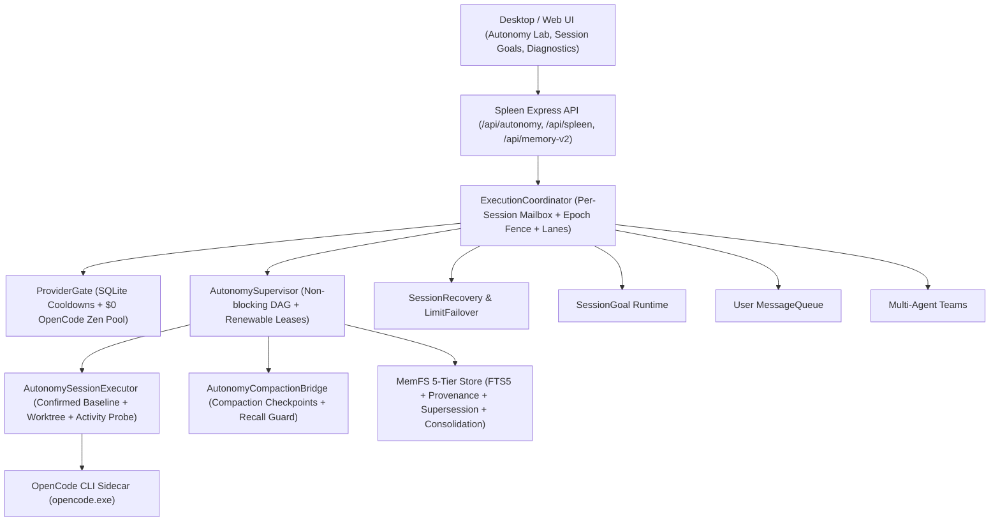

# Spleen Autonomous Agent Harness — Architecture & Operations Guide

Spleen's autonomous harness coordinates persistent finite and ongoing objectives, session goals, automatic usage-limit recovery, `$0`-cost OpenCode Zen model failover, multi-agent DAG execution, context compaction checkpoints, 5-tier memory (`MemFS`), and desktop background lifecycle under a single authoritative runtime.

---

## 1. System Architecture

### Authoritative Execution Coordinator (`packages/web/server/lib/execution-coordinator/`)
Previously, `autonomy`, `session-recovery`, `session-goal`, `message-queue`, `teams`, and `scheduled-tasks` could dispatch prompts independently when a session went idle. All automated dispatchers now coordinate through `ExecutionCoordinator`:

1. **Per-Session Deterministic Arbitration**:
   - **Priority 1 — Explicit User Queue (`message-queue` / `interactive`)**: User-queued messages always preempt automated continuations.
   - **Priority 2 — Usage-Limit & Interrupted-Turn Recovery (`recovery`)**: Resumes interrupted turns or waits out provider cooldowns before any higher-level loop sends new prompts.
   - **Priority 3 — Active Session Controller (`autonomy` > `team` > `session-goal` > `scheduled`)**: Only one controller owns automated continuations on a given `sessionId` at a time.
2. **Non-Blocking Concurrency Lanes (`lanes.js`)**:
   - Independent worker pools (`interactive`, `recovery`, `autonomy`, `team`, `subagent`, `scheduled`) prevent slow tasks or parked objectives from head-of-line blocking other objectives or interactive chats.
3. **Monotonic Epoch Fencing (`epoch` & `runEpoch`)**:
   - Every pause, cancel, or emergency stop increments the objective and coordinator epochs, aborts local worker fibers, interrupts OpenCode (`session.interrupt` on both parent and active child subagent sessions), and rejects stale post-abort writes via SQLite compare-and-swap (`updateTaskIfEpoch`).

---

## 2. Objective Execution Lifecycle

### Finite Objectives (`mode: "finite"`)
- Decomposed into an explicit task DAG (`dependsOn`, `role`, `kind`, `acceptanceCriteria`).
- Ready tasks execute concurrently up to `budget.maxParallel` (default `2`, configurable `1..8`), optionally isolated in per-task Git worktrees (`useWorktrees: true`).
- Completes **only** when every task in the DAG is `completed` **and** every configured `verificationCommands` entry exits `0`.
- Failed verification automatically creates a targeted `Fix verification failure: <command>` task carrying the failing stdout/stderr excerpt.

### Ongoing Objectives (`mode: "ongoing"`)
- Default to **unlimited turns** (`budget.maxTurns = null`) and **unlimited runtime** (`budget.maxRuntimeMs = null`) unless an explicit cap is configured.
- Cycle continuously through:
  1. Execute ready tasks ->
  2. Run verification commands ->
  3. Sleep cleanly (`status = "waiting"`, `nextWakeAt = now + reviewIntervalMs`) ->
  4. Wake automatically on timer or event to start the next cycle.
- Remain operational until explicitly paused, cancelled, or a user-configured budget boundary is reached.

### Confirmed Turn Delivery & Activity-Aware Leases
- **No Unconfirmed Completion**: Before sending a prompt, `AutonomySessionExecutor` records the session's latest completed assistant message ID (`baselineMessageId`). A turn only succeeds when a **new** post-baseline assistant turn completes with non-empty content or tool execution.
- **Backend Unavailability Immunity**: If `readSessionStatus` returns `null` while `opencode.exe` restarts, the poll is classified as `backend_unavailable` — never mistaken for `idle` or `failed`.
- **Renewable Leases**: Heartbeats renew both `heartbeatAt` and `leaseUntil`. Active child subagents (`hasWorkingDescendants`) and running background commands (`fetchRunningBackgroundJobs`) count as live progress, renewing leases and resetting inactivity timers so long builds/research never false-timeout.
- **Semantic Anti-Stagnation**: Consecutive identical task outputs increment `stagnationStreak`. Reaching the threshold triggers an automatic `[Replan]` architect task to change strategy rather than repeating `"Continue"`.

---

## 3. Automatic Usage-Limit Recovery & Free OpenCode Zen Failover

Designed first-class for `$0` free OpenCode Zen models:

1. **Zero Retry/Goal Destruction on Rate Limits**:
   - When a `429`, `provider.free-limit`, `provider.quota`, `UsageLimitError`, or transient provider outage occurs:
     - `AutonomySupervisor` returns the task to `pending` with **zero** `attempts` or `failureStreak` increment (`providerWaits + 1`), sets `waitingReason = "waiting_provider"` and `waitingUntil = resetAt`, and schedules an exact wakeup timer.
     - `SessionGoalRuntime` holds the goal `active` (`statusReason = "waiting for provider limit reset"`) instead of marking it `blocked`.
     - `TeamsService` returns the team task to `pending` instead of marking it `failed`.
2. **Verified `$0` OpenCode Zen Pool (`ProviderGate`)**:
   - Queries OpenCode's live `/provider` catalog and selects models belonging to the `opencode` / `opencode-zen` free Zen pool where `cost.input === 0`, `cost.output === 0`, and `cost.cache_read === 0` (strictly excluding paid models and subscription-gated `opencode-go` models).
   - Persists per-`(providerID, modelID, credentialID)` cooldown windows in `provider-gate.sqlite3` across process restarts, parsing retry headers and natural-language reset timestamps.
   - Silently rotates blocked sessions onto healthy `$0` Zen models (`kind: "free-zen-model"` — zero toast spam) and automatically restores the user's primary model once its cooldown expires.

---

## 4. Context Compaction Continuity

`AutonomyCompactionBridge` listens for OpenCode compaction events (`session.compacted`, `message.part.updated` compaction parts):
- Captures a durable `compaction` checkpoint in `autonomy_checkpoints` (`compactionEpoch`, objective description, completed/pending/failed tasks, verification summary, and next action).
- Flushes an episodic snapshot into `MemFS` (`originClass: "agent"`, `sessionKind: "autonomous"`).
- Subsequent turns inject both the `Compaction Continuity Anchor (Epoch #N)` and the latest turn checkpoint into the structured prompt so agents never lose acceptance criteria or repeat finished work after context window compaction.

---

## 5. Persistent 5-Tier Memory (`MemFS`)

Stored in `memfs.sqlite3` (SQLite FTS5):
- **Tiers**: `working`, `episodic`, `semantic`, `procedural`, `archive`.
- **Provenance & Quarantine**: Tracks `originClass` (`owner`, `agent`, `untrusted`, `system`) and `sessionKind`. `untrusted` or prompt-injection-flagged entries are quarantined from `semantic`/`procedural` promotion.
- **Recall-Loop Guard**: Recalled memories injected into prompts are wrapped in `<spleen-recalled-context>...</spleen-recalled-context>` and stripped prior to memory curation/storage.
- **Supersession & Consolidation**: `supersessionKey` archives superseded facts automatically; `POST /api/memory-v2/consolidate` promotes recurring verified episodic insights into durable semantic knowledge.

---

## 6. Desktop Background Execution & Lifecycle

- **System Tray Persistence**: With `minimize_to_tray` enabled (default `true`), closing the Spleen window hides the UI to the Windows system tray while keeping `spleen-server.exe`, `opencode.exe`, and all autonomous loops running.
- **Automatic Windows Awake Lock**: A background monitor in `packages/desktop/src-tauri/src/main.rs` polls `/api/diagnostics/overview`, automatically engaging `set_keep_awake` (`ES_CONTINUOUS | ES_SYSTEM_REQUIRED`) whenever autonomous objectives or recoveries are active, and updating the tray tooltip (`Spleen — N autonomous active`).
- **Authenticated Graceful Shutdown**: `ServerProcess.client_token` is persisted after `sidecar::login`, so `POST /api/system/shutdown` executes cleanly (`200 OK`), flushing SQLite WAL checkpoints and terminating managed OpenCode child processes without orphan processes or timeout delays.

---

## 7. Configuration & Troubleshooting

### Key API Endpoints
- `GET /api/autonomy/objectives` / `POST /api/autonomy/objectives` — list or create finite/ongoing objectives (`mode`, `maxParallel`, `useWorktrees`, `verificationCommands`, `budget`).
- `GET /api/autonomy/coordinator` — inspect lane concurrency, active session owners, `$0` free Zen model pool, active failovers, and provider cooldowns.
- `POST /api/autonomy/cooldowns/clear` — manually clear provider cooldown timers.
- `POST /api/autonomy/emergency-stop` — bump all active objective epochs, abort in-flight workers, and interrupt active OpenCode sessions + descendant subagents.
- `POST /api/memory-v2/consolidate` — run 2-gate episodic -> semantic consolidation.

### Troubleshooting
- **Objective shows `waiting quota` (`waiting_provider`)**: All candidate models in the session's failover chain are currently inside a provider rate-limit window. Inspect exact reset timestamps in **Autonomy Lab -> Coordinator & Diagnostics -> Provider Cooldowns**, or enable **Free Zen Failover** in settings so Spleen can rotate across `$0` OpenCode Zen models.
- **Verification loop spawns `Fix verification failure` task**: Inspect **Verification Evidence** on the objective card to view the exact exit code and stdout/stderr of the failing command. Ensure `verificationCommands` only run tests scoped to your project directory rather than unrelated subdirectories.
- **Emergency stop**: Click **Emergency Stop All** in **Autonomy Lab** to immediately interrupt every running autonomous objective and child subagent session.
